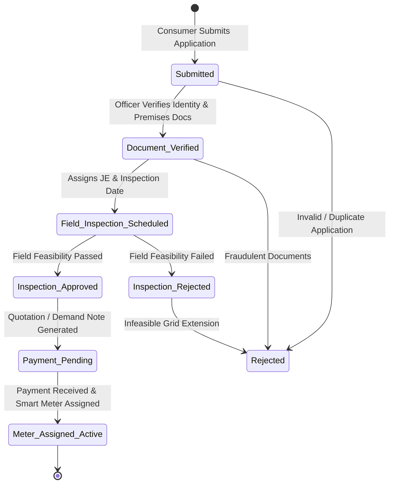

# 🏗️ VoltFlow — System Architecture & Design Document

---

## 1. Architectural Philosophy & Overview

**VoltFlow** employs a **Layered Clean Architecture** separating presentation, business logic, data access, and persistence. This decoupled design ensures testability, maintainability, and clean migration paths between development (SQLite) and production (PostgreSQL).

```
┌─────────────────────────────────────────────────────────────────────────┐
│                           PRESENTATION LAYER                            │
│                                                                         │
│  ┌───────────────────────┐  ┌───────────────────────┐  ┌─────────────┐  │
│  │ Single Page Interface │  │ Component Controllers │  │  Fetch API  │  │
│  │   (HTML5 Semantic)    │  │   (Modals, Toasts)    │  │ Client REST │  │
│  └───────────────────────┘  └───────────────────────┘  └─────────────┘  │
└────────────────────────────────────┬────────────────────────────────────┘
                                     │ HTTP / HTTPS (JSON)
                                     ▼
┌─────────────────────────────────────────────────────────────────────────┐
│                             API ROUTE LAYER                             │
│                                                                         │
│  ┌──────────────────┐  ┌──────────────────┐  ┌───────────────────────┐  │
│  │  /api/v1/apps    │  │ /api/v1/inspect  │  │   /api/v1/meters      │  │
│  └──────────────────┘  └──────────────────┘  └───────────────────────┘  │
│  ┌──────────────────┐  ┌──────────────────┐  ┌───────────────────────┐  │
│  │  /api/v1/stats   │  │ /api/v1/grievance│  │     /health           │  │
│  └──────────────────┘  └──────────────────┘  └───────────────────────┘  │
└────────────────────────────────────┬────────────────────────────────────┘
                                     │ Injects & Validates (Pydantic)
                                     ▼
┌─────────────────────────────────────────────────────────────────────────┐
│                          BUSINESS SERVICE LAYER                         │
│                                                                         │
│  ├── ApplicationService (Quotation logic, Lifecycle rules, Numbering)   │
│  ├── InspectionService (Feasibility checks, pole distance validations)  │
│  ├── MeterService (Serial validation, grid allocation, readings)        │
│  ├── GrievanceService (Priority dispatch, SLA resolution)               │
│  └── StatsService (KPI aggregation, load metrics, feeder health)        │
└────────────────────────────────────┬────────────────────────────────────┘
                                     │ Session Scoped (SQLAlchemy ORM)
                                     ▼
┌─────────────────────────────────────────────────────────────────────────┐
│                           DATA PERSISTENCE LAYER                        │
│                                                                         │
│    Consumers ──< Applications ──< Inspections ──< Meters                │
│                         └──< AuditLogs                                  │
│    Consumers ──< Grievances                                             │
│                                                                         │
│        [SQLite : Local Development] ──► [PostgreSQL : Production]       │
└─────────────────────────────────────────────────────────────────────────┘
```

---

## 2. Directory Structure

```text
d:\mini_proj13\
│
├── frontend/
│   ├── index.html              # Main multi-view application shell
│   ├── css/
│   │   ├── style.css           # Core design system, variables, typography, cards
│   │   └── responsive.css      # Breakpoints (mobile, tablet, desktop)
│   ├── js/
│   │   ├── config.js           # Environment API endpoints, category definitions
│   │   ├── api.js              # Centralized HTTP Fetch client with error handling
│   │   ├── ui.js               # Toast notifications, modal helpers, formatting
│   │   └── app.js              # Application state, event listeners, view routers
│   └── assets/
│       └── logo.svg            # Modern SVG logo for VoltFlow
│
├── backend/
│   ├── app/
│   │   ├── __init__.py
│   │   ├── main.py             # FastAPI entrypoint, middleware, CORS, routers
│   │   ├── config.py           # Pydantic BaseSettings, environment variables
│   │   ├── models/             # SQLAlchemy ORM database models
│   │   │   ├── __init__.py
│   │   │   ├── consumer.py
│   │   │   ├── application.py
│   │   │   ├── inspection.py
│   │   │   ├── meter.py
│   │   │   ├── grievance.py
│   │   │   └── audit_log.py
│   │   ├── schemas/            # Pydantic request/response validation schemas
│   │   │   ├── __init__.py
│   │   │   ├── consumer.py
│   │   │   ├── application.py
│   │   │   ├── inspection.py
│   │   │   ├── meter.py
│   │   │   ├── grievance.py
│   │   │   └── stats.py
│   │   ├── database/           # Engine, SessionLocal, Base, seeding logic
│   │   │   ├── __init__.py
│   │   │   ├── connection.py
│   │   │   └── seed_data.py
│   │   ├── services/           # Reusable business logic layer
│   │   │   ├── __init__.py
│   │   │   ├── application_service.py
│   │   │   ├── inspection_service.py
│   │   │   ├── meter_service.py
│   │   │   ├── grievance_service.py
│   │   │   └── stats_service.py
│   │   ├── routes/             # REST API Endpoints
│   │   │   ├── __init__.py
│   │   │   ├── applications.py
│   │   │   ├── inspections.py
│   │   │   ├── meters.py
│   │   │   ├── grievances.py
│   │   │   └── stats.py
│   │   └── utils/              # Helper functions, quotation calculators
│   │       ├── __init__.py
│   │       └── helpers.py
│   ├── requirements.txt        # Pinned python dependencies
│   ├── .env.example            # Environment template
│   └── README.md
│
├── database/
│   ├── schema.sql              # Raw SQL DDL definition
│   └── seed.sql                # Realistic initial SQL dataset
│
├── tests/
│   ├── __init__.py
│   ├── conftest.py             # Test database fixture & test HTTP client
│   └── backend/
│       ├── __init__.py
│       ├── test_health.py
│       ├── test_applications.py
│       ├── test_inspections.py
│       ├── test_meters.py
│       └── test_grievances.py
│
├── docs/
│   ├── PROJECT_SPECIFICATION.md
│   ├── ARCHITECTURE.md
│   ├── DATABASE.md
│   ├── API_DOCUMENTATION.md
│   ├── DEPLOYMENT.md
│   └── USER_GUIDE.md
│
├── .gitignore
├── README.md
├── Dockerfile
└── docker-compose.yml
```

---

## 3. Application State & Lifecycle State Machine



---

## 4. Quotation Calculation Algorithm

Quotation estimates are computed systematically by the `ApplicationService` based on statutory discom tariff slabs:

$$\text{Total Quotation} = \text{Security Deposit} + \text{Service Connection Fee} + \text{Meter & Installation Fee}$$

| Consumer Category | Security Deposit per kW | Service Connection Base | Phase Cost Factor |
| :--- | :--- | :--- | :--- |
| **Domestic (LT-1)** | ₹ 600 / kW | ₹ 1,200 | $1.0\times$ (1-Ph) / $1.8\times$ (3-Ph) |
| **Commercial (LT-2)** | ₹ 1,200 / kW | ₹ 2,500 | $1.0\times$ (1-Ph) / $1.7\times$ (3-Ph) |
| **Industrial (HT-1)** | ₹ 2,500 / kW | ₹ 8,000 | $2.5\times$ (3-Phase Required) |
| **Agricultural (LT-4)** | ₹ 200 / kW | ₹ 800 (Subsidized) | $1.0\times$ (1-Ph) / $1.2\times$ (3-Ph) |

---

## 5. Security & Validation Architecture

1. **Pydantic Validation**: Ensures phone numbers match 10-digit formats, requested loads satisfy bounds ($1\le\text{load}\le 500\text{ kW}$), and emails conform to standard formats.
2. **CORS Security**: Restricted to verified development and production client origins.
3. **Database Transactions**: Atomically commits multi-entity updates (e.g. creating audit log upon status transition), with automated rollbacks on any uncaught exceptions.
4. **Error Masking**: Handled through a centralized exception handler returning standard JSON format:
   ```json
   {
     "success": false,
     "error": "Resource Not Found",
     "message": "Application with ID APP-2026-9999 was not found",
     "status_code": 404
   }
   ```
