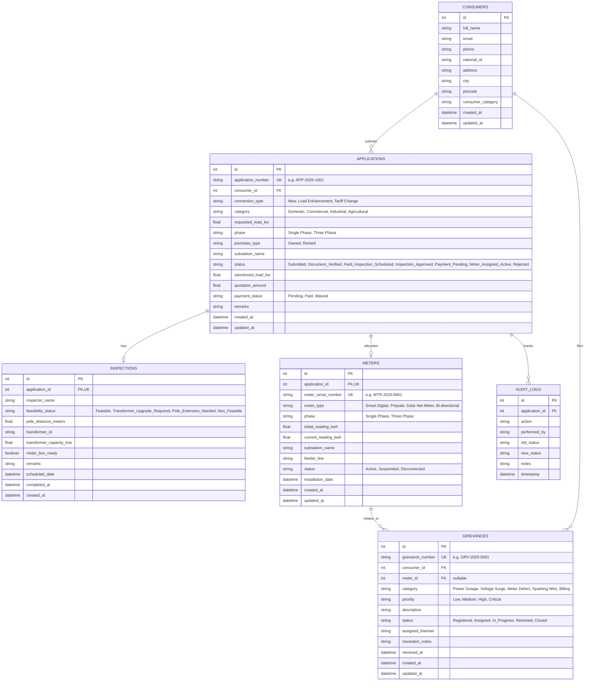

# 🗄️ VoltFlow — Database Schema & Data Dictionary

---

## 1. Relational Entity Relationship (ER) Model

---

## 2. Table Schemas & Constraints

### 2.1 Table: `consumers`
Represents the individuals or business entities registering for electricity services.

| Column | Type | Constraints | Description |
| :--- | :--- | :--- | :--- |
| `id` | INTEGER | PRIMARY KEY, AUTOINCREMENT | Unique consumer identifier |
| `full_name` | VARCHAR(120) | NOT NULL | Full name of consumer |
| `email` | VARCHAR(120) | NOT NULL, INDEX | Consumer email address |
| `phone` | VARCHAR(15) | NOT NULL, INDEX | 10-15 digit phone number |
| `national_id` | VARCHAR(20) | NOT NULL | Aadhaar / National ID |
| `address` | TEXT | NOT NULL | Complete premises street address |
| `city` | VARCHAR(80) | NOT NULL | City / Municipality |
| `pincode` | VARCHAR(10) | NOT NULL | Postal index code |
| `consumer_category` | VARCHAR(30) | NOT NULL | Domestic, Commercial, Industrial, Agricultural |
| `created_at` | DATETIME | NOT NULL, DEFAULT CURRENT_TIMESTAMP | Record creation timestamp |
| `updated_at` | DATETIME | NOT NULL, DEFAULT CURRENT_TIMESTAMP | Last update timestamp |

### 2.2 Table: `applications`
Core lifecycle entity for electricity connection requests.

| Column | Type | Constraints | Description |
| :--- | :--- | :--- | :--- |
| `id` | INTEGER | PRIMARY KEY, AUTOINCREMENT | Primary record identifier |
| `application_number` | VARCHAR(30) | NOT NULL, UNIQUE, INDEX | Unique application tracking ID |
| `consumer_id` | INTEGER | NOT NULL, FOREIGN KEY (`consumers.id`) | Reference to applicant |
| `connection_type` | VARCHAR(40) | NOT NULL | New Connection, Load Enhancement, Tariff Change |
| `category` | VARCHAR(30) | NOT NULL | Tariff category (Domestic, Commercial, etc.) |
| `requested_load_kw` | FLOAT | NOT NULL | Requested power load in kilowatts |
| `phase` | VARCHAR(20) | NOT NULL | Single Phase or Three Phase |
| `premises_type` | VARCHAR(20) | NOT NULL | Owned, Rented, Leased |
| `substation_name` | VARCHAR(100) | NOT NULL | Target distribution substation |
| `status` | VARCHAR(40) | NOT NULL, DEFAULT 'Submitted' | Current lifecycle status |
| `sanctioned_load_kw` | FLOAT | NULL | Final approved load in kW |
| `quotation_amount` | FLOAT | NOT NULL, DEFAULT 0.0 | Demand note quotation charge in ₹ |
| `payment_status` | VARCHAR(20) | NOT NULL, DEFAULT 'Pending' | Pending, Paid, Waived |
| `remarks` | TEXT | NULL | Officer or system remarks |
| `created_at` | DATETIME | NOT NULL, DEFAULT CURRENT_TIMESTAMP | Submission timestamp |
| `updated_at` | DATETIME | NOT NULL, DEFAULT CURRENT_TIMESTAMP | Last modification timestamp |

### 2.3 Table: `inspections`
Field feasibility and technical site survey records.

| Column | Type | Constraints | Description |
| :--- | :--- | :--- | :--- |
| `id` | INTEGER | PRIMARY KEY, AUTOINCREMENT | Unique inspection identifier |
| `application_id` | INTEGER | NOT NULL, UNIQUE, FOREIGN KEY (`applications.id`) | Associated connection application |
| `inspector_name` | VARCHAR(100) | NOT NULL | Assigned Junior Engineer / Officer |
| `feasibility_status` | VARCHAR(40) | NOT NULL, DEFAULT 'Feasible' | Feasible, Pole_Extension_Needed, etc. |
| `pole_distance_meters` | FLOAT | NOT NULL, DEFAULT 25.0 | Distance from nearest grid pole |
| `transformer_id` | VARCHAR(40) | NOT NULL | Reference distribution transformer ID |
| `transformer_capacity_kva`| FLOAT | NOT NULL, DEFAULT 100.0 | Total rated transformer capacity |
| `meter_box_ready` | BOOLEAN | NOT NULL, DEFAULT TRUE | Site readiness for meter housing |
| `remarks` | TEXT | NULL | Inspector field notes |
| `scheduled_date` | DATETIME | NOT NULL | Date scheduled for site visit |
| `completed_at` | DATETIME | NULL | Timestamp of survey completion |
| `created_at` | DATETIME | NOT NULL, DEFAULT CURRENT_TIMESTAMP | Record creation timestamp |

### 2.4 Table: `meters`
Installed smart meter devices and grid allocation registry.

| Column | Type | Constraints | Description |
| :--- | :--- | :--- | :--- |
| `id` | INTEGER | PRIMARY KEY, AUTOINCREMENT | Unique meter record identifier |
| `application_id` | INTEGER | NOT NULL, UNIQUE, FOREIGN KEY (`applications.id`) | Linked application |
| `meter_serial_number` | VARCHAR(40) | NOT NULL, UNIQUE, INDEX | Unique hardware serial number |
| `meter_type` | VARCHAR(40) | NOT NULL | Smart Digital, Prepaid, Solar Net-Meter |
| `phase` | VARCHAR(20) | NOT NULL | Single Phase, Three Phase |
| `initial_reading_kwh`| FLOAT | NOT NULL, DEFAULT 0.0 | Baseline energy meter reading |
| `current_reading_kwh`| FLOAT | NOT NULL, DEFAULT 0.0 | Current recorded energy consumption |
| `substation_name` | VARCHAR(100) | NOT NULL | Grid substation feeding this meter |
| `feeder_line` | VARCHAR(100) | NOT NULL | 11kV Feeder Line Identifier |
| `status` | VARCHAR(20) | NOT NULL, DEFAULT 'Active' | Active, Suspended, Disconnected |
| `installation_date` | DATETIME | NOT NULL, DEFAULT CURRENT_TIMESTAMP | Installation timestamp |
| `created_at` | DATETIME | NOT NULL, DEFAULT CURRENT_TIMESTAMP | Record creation timestamp |
| `updated_at` | DATETIME | NOT NULL, DEFAULT CURRENT_TIMESTAMP | Update timestamp |

### 2.5 Table: `grievances`
Power failure, breakdown, voltage surge, and service tickets.

| Column | Type | Constraints | Description |
| :--- | :--- | :--- | :--- |
| `id` | INTEGER | PRIMARY KEY, AUTOINCREMENT | Grievance ticket identifier |
| `grievance_number` | VARCHAR(30) | NOT NULL, UNIQUE, INDEX | Ticket number e.g. `GRV-2026-5001` |
| `consumer_id` | INTEGER | NOT NULL, FOREIGN KEY (`consumers.id`) | Reporting consumer |
| `meter_id` | INTEGER | NULL, FOREIGN KEY (`meters.id`) | Optional linked meter |
| `category` | VARCHAR(40) | NOT NULL | Outage, Voltage, Meter, Sparking |
| `priority` | VARCHAR(20) | NOT NULL, DEFAULT 'Medium' | Low, Medium, High, Critical |
| `description` | TEXT | NOT NULL | Incident description |
| `status` | VARCHAR(30) | NOT NULL, DEFAULT 'Registered' | Registered, In_Progress, Resolved |
| `assigned_lineman` | VARCHAR(100) | NULL | Assigned field electrician / lineman |
| `resolution_notes` | TEXT | NULL | Details of repair / resolution |
| `resolved_at` | DATETIME | NULL | Timestamp of resolution |
| `created_at` | DATETIME | NOT NULL, DEFAULT CURRENT_TIMESTAMP | Filing timestamp |
| `updated_at` | DATETIME | NOT NULL, DEFAULT CURRENT_TIMESTAMP | Last update timestamp |

### 2.6 Table: `audit_logs`
Immutable audit trail for all application lifecycle state changes.

| Column | Type | Constraints | Description |
| :--- | :--- | :--- | :--- |
| `id` | INTEGER | PRIMARY KEY, AUTOINCREMENT | Log entry identifier |
| `application_id` | INTEGER | NOT NULL, FOREIGN KEY (`applications.id`) | Target application |
| `action` | VARCHAR(60) | NOT NULL | Event name (e.g., 'STATUS_UPDATE') |
| `performed_by` | VARCHAR(100) | NOT NULL | User or System agent |
| `old_status` | VARCHAR(40) | NULL | Previous state |
| `new_status` | VARCHAR(40) | NOT NULL | New state |
| `notes` | TEXT | NULL | Context or reason |
| `timestamp` | DATETIME | NOT NULL, DEFAULT CURRENT_TIMESTAMP | Time of action |
